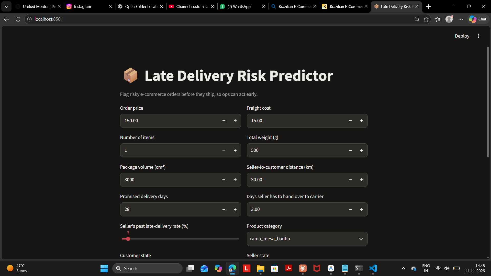
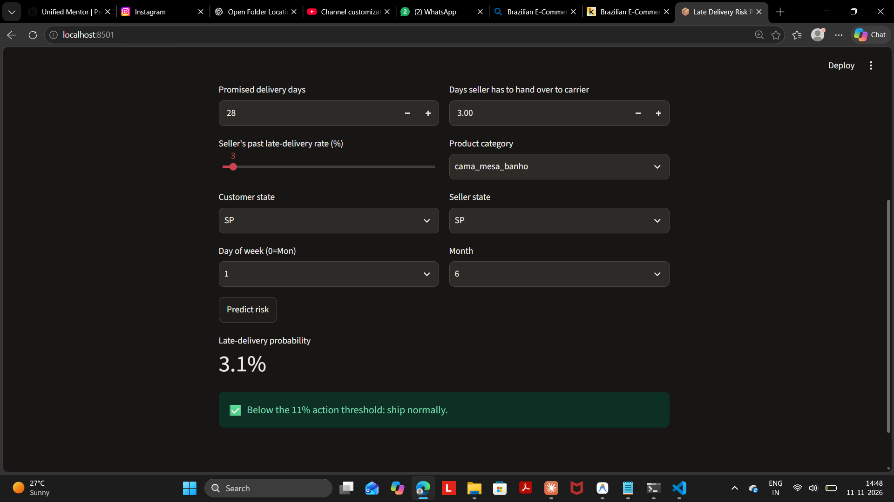
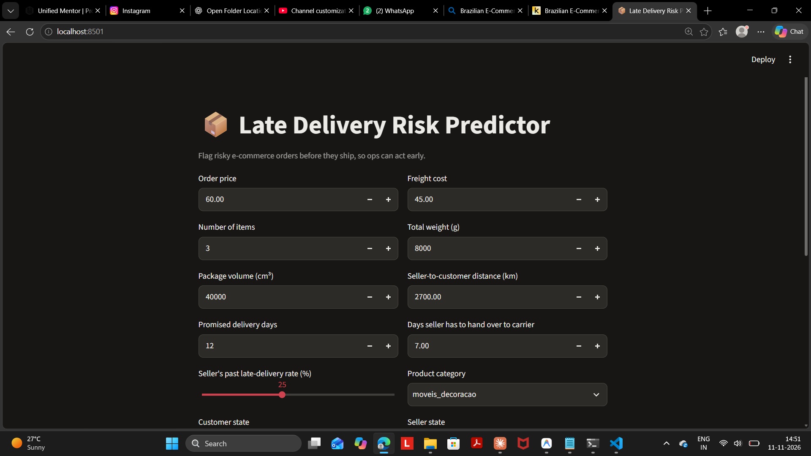
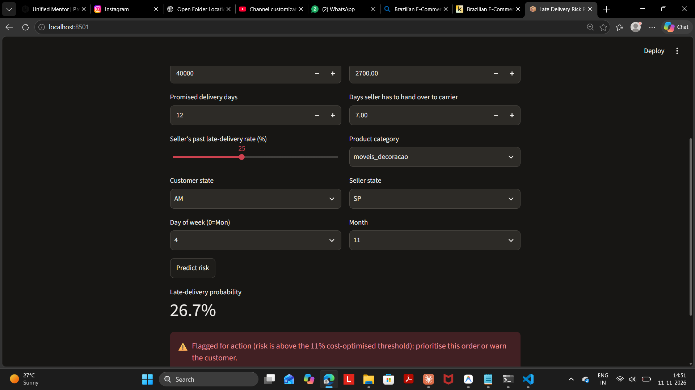
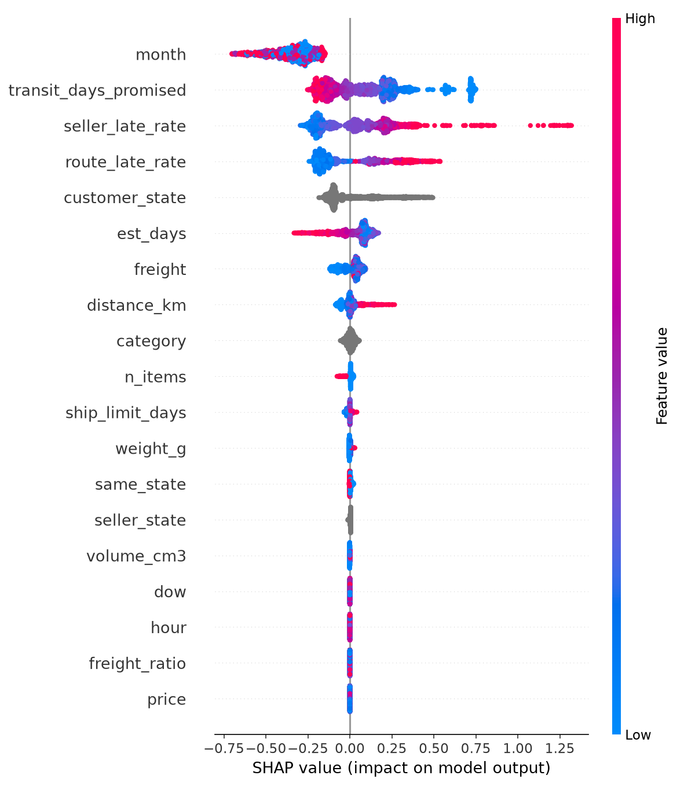

# 📦 Late Delivery Risk Predictor (E-commerce Analytics)

## Problem
Late deliveries cause bad reviews, refunds, support tickets and lost customers. This project predicts **which orders are likely to be delivered late at the time they are placed**, so an operations team can act early (priority handling, shipping upgrade, proactive customer message).

## Dataset
[Brazilian E-Commerce Public Dataset by Olist](https://www.kaggle.com/datasets/olistbr/brazilian-ecommerce): about 96k delivered orders across orders, items, products, customers, sellers and geolocation tables.

## Approach
- **Target:** order delivered after the promised delivery date (about 8% of orders).
- **Features (only information known at order time):** price, freight, weight, volume, seller-to-customer distance, promised delivery days, seller handover deadline, product category, states, purchase day/month/hour.
- **History features:** each seller's past late rate and each seller-state to customer-state route's past late rate, calculated with out-of-fold target encoding so no future information leaks in.
- **Validation:** time-based split (train on the earlier 80% of orders, test on the latest 20%) to mimic real deployment.
- **Models:** Logistic Regression baseline vs LightGBM with early stopping.
- **Explainability:** SHAP summary plot.
- **Deployment:** Streamlit app.

## Results (time-based test set)

| Model | ROC-AUC | PR-AUC |
|---|---|---|
| Random guessing | 0.500 | 0.053 |
| Logistic Regression (baseline) | 0.711 | 0.107 |
| **LightGBM** | **0.765** | **0.132** |

- The **top 10% riskiest orders are late 16.8% of the time vs 5.3% overall (3.2x lift)**.
- Note: the late rate in the test period (5.3%) is lower than in training (8.8%), so this is a hard, realistic test.

## Business impact (assumed numbers)
Assumptions: a late order costs 100 (refund, support, churn); a proactive action costs 5 per flagged order; the action prevents 40% of the late-order cost. These numbers are **assumptions for illustration**, not real company data.

With a cost-optimised threshold of 0.11, the model reduces simulated cost by about **4%, or about 210 per 1000 orders**, compared to doing nothing.
## Demo app

Low-risk order:
## Demo app

Low-risk order:



High-risk order:


High-risk order:


## SHAP explanation


## Run it yourself
```
pip install pandas numpy lightgbm scikit-learn shap matplotlib joblib streamlit
# download the Olist CSVs into ./data/
python train.py
streamlit run app.py
```

## Limitations and next steps
- Cost assumptions should be replaced with real company numbers.
- The dataset covers only 2016-2018 and one Brazilian marketplace.
- Next: add carrier-level data, weather and holiday features, and probability calibration.